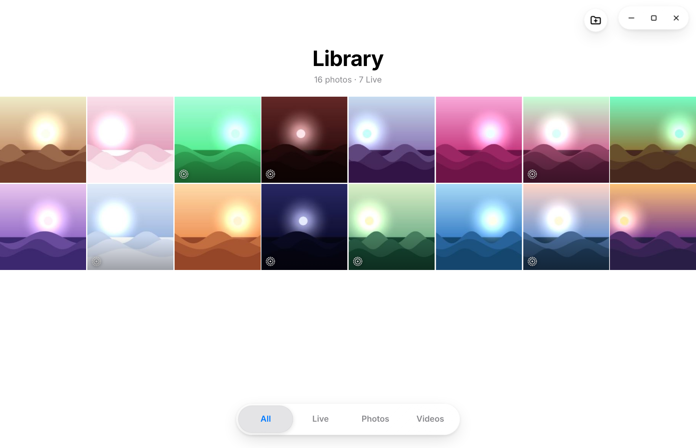
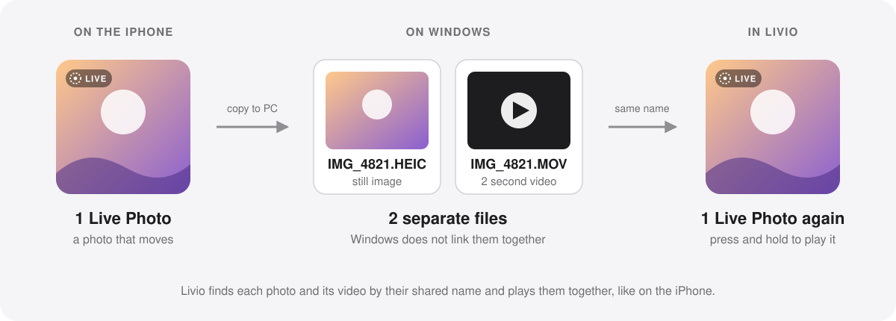
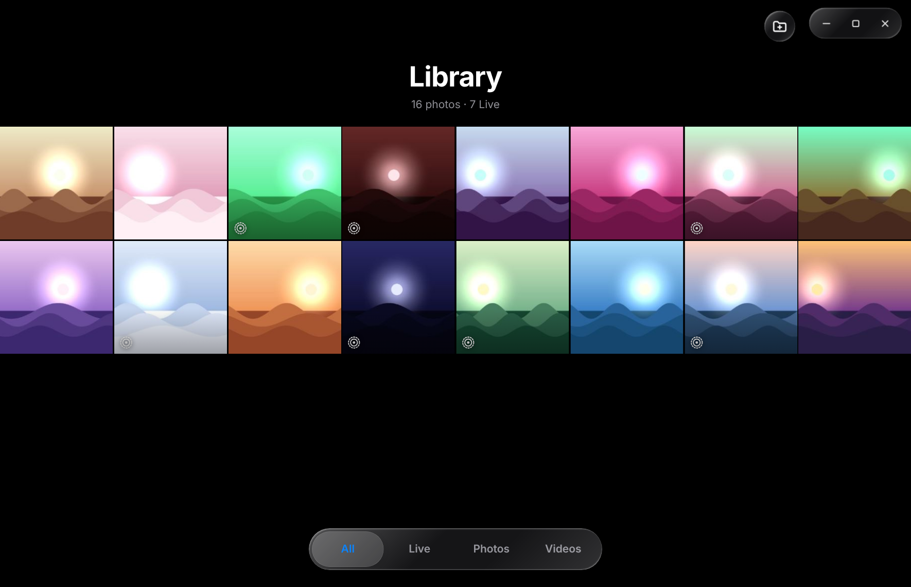
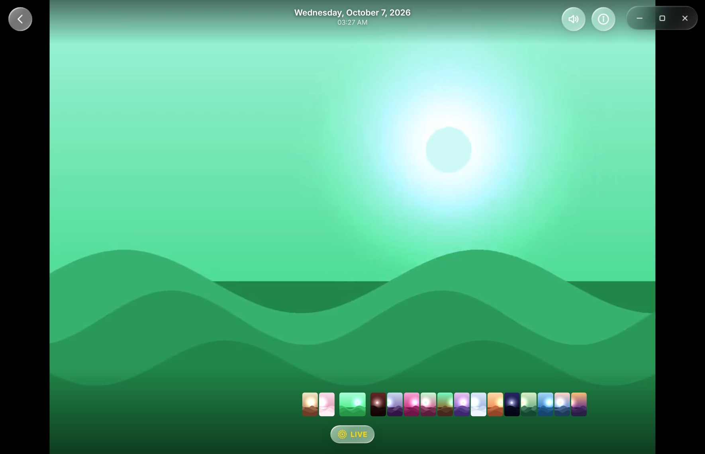
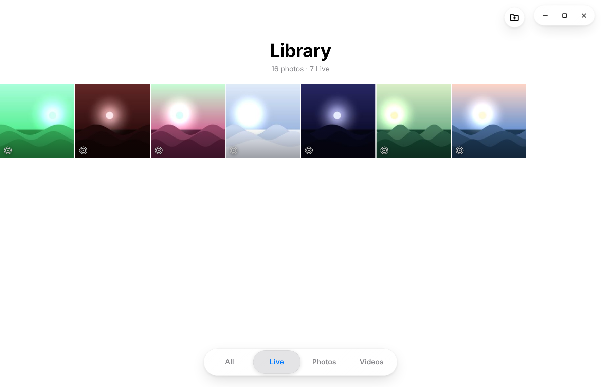
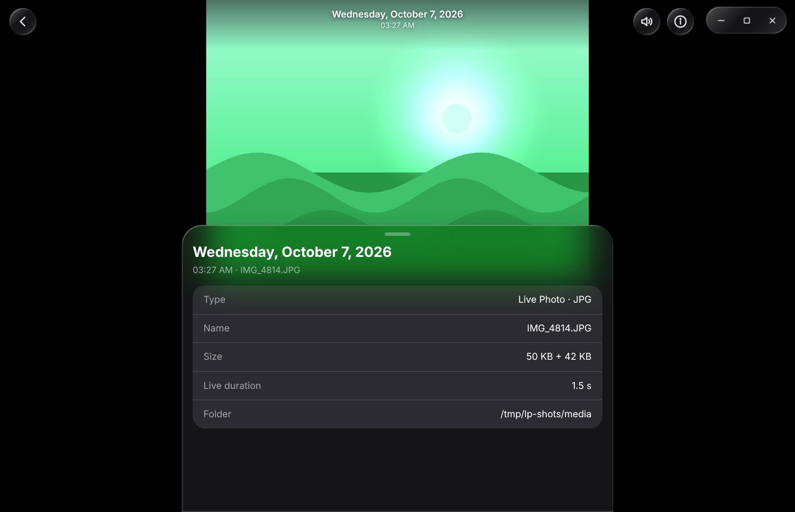

# Livio

Livio is a **portable** Windows viewer for **iPhone Live Photos**, with an iOS-style interface and *liquid glass* look. Press and hold a photo and it moves, just like on your iPhone.



## The problem

On an iPhone, a Live Photo is **one** item: a photo that moves when you press and hold it.

When you copy it to a Windows PC, it is split into **two separate files**: a still image (`.HEIC` or `.JPG`) and a short video (`.MOV`) with the same name. Windows shows them as two unrelated files, so you never see the live photo: you get either a still picture or a video, never both together.

**Livio puts them back together.** It matches each photo with its video by name and plays them as a Live Photo again.



## Easy to use

1. **Copy the photos from your iPhone.** Connect it with the cable, unlock it, and in File Explorer open **This PC › Apple iPhone › Internal Storage › DCIM**. Copy the folders to your PC. Keep the photo and its `.MOV` in the same folder.
2. **Open Livio** (`Livio.exe`, nothing to install) and click the folder icon at the top right, or press `Ctrl+O`. Choose the folder you copied.
3. **Press and hold** any photo with the LIVE badge to watch it move.

That is all. Photos without a matching video are shown as normal photos.

> Tip: on the iPhone, in **Settings › Photos**, under **Transfer to Mac or PC**, choose **Keep Originals** so that the photos are copied as they were taken.

## Features

- **Press and hold** a photo to play its Live Photo (with sound). Release and the still comes back.
- **Swipe between photos**: arriving on a Live Photo plays it once, then it returns to the still image, like on iPhone.
- **Grid library** with a LIVE badge, a large title that shrinks as you scroll, and an *All / Live / Photos / Videos* filter bar.
- **Light and dark theme**, following your Windows setting.
- **Info sheet** (drag up): date, type, size, Live Photo duration, folder.
- **Thumbnail strip** for quick browsing and a scroll rail in the library.
- **HEIC photos read directly** by the app (libheif decoder in WebAssembly), so no Windows image extension is needed for photos.
- **Portable**: nothing to install, settings stay in a `data` folder next to the executable.
- Your photos stay on your PC: nothing is copied or uploaded.

| Dark theme | Live Photo playing |
| --- | --- |
|  |  |

| Live filter | Info sheet |
| --- | --- |
|  |  |

> The screenshots use sample photos generated for this README and were captured in headless Chromium, so the font may differ from what you see on Windows.

## Controls

| Action | How |
| --- | --- |
| Open a photo | Click the thumbnail |
| Play the Live Photo | Press and hold the photo |
| Previous / next photo | Drag left or right, or use the arrow keys |
| Back to the library | Drag down, or use the back button |
| Info sheet | Drag up |
| Full screen | `F11` |
| Open a folder | Folder icon or `Ctrl+O` |

## Requirements

- Windows 10 or 11, 64-bit.
- **Microsoft Edge WebView2 Runtime**, already included in Windows 11 and most Windows 10 installs.
- If the video of a Live Photo does not play (some iPhones store it as HEVC), install **HEVC Video Extensions** from the Microsoft Store. Microsoft's package is not included in this repository.

## Repository layout

```
Livio.exe           Native host (WebView2 window)
icon.ico            App icon
renderer/
  index.html        Interface structure
  style.css         iOS look and liquid glass
  app.js            Library, viewer, gestures, Live Photo playback
  lp.js             Bridge to the native host
  imgworker.js      Worker that decodes photos (including HEIC)
  vendor/           libheif (HEIC decoder) and its license
docs/                README images (screenshots and the how-it-works diagram)
```

The interface is plain HTML, CSS and JavaScript with no dependencies to install: you can edit it directly in the `renderer` folder.

## Notes

- The repository contains the prebuilt executable. The source code of the native host is not included.
- HEIC decoding uses [libheif-js](https://github.com/catdad-experiments/libheif-js), distributed under LGPL-3.0 (text in `renderer/vendor/LICENSE-libheif.txt`).
